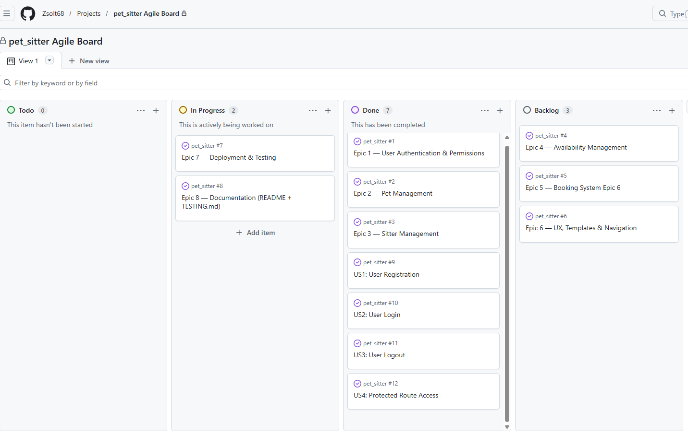
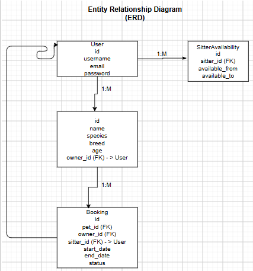

# Pet Sitter

## Live Site
https://pet-sitter-1461e274cc14.herokuapp.com/

## GitHub Repository
https://github.com/Zsolt68/pet_sitter


## UX Design
The UX design follows the five‑plane model: Strategy, Scope, Structure, Skeleton, and Surface.  
The goal is to provide a clean, intuitive interface for managing pets and bookings with minimal friction.

## Agile Methodology

### Agile Development

The Pet Sitter project was developed using Agile principles throughout the software development lifecycle. Features were planned and managed using a GitHub Project Board, allowing tasks to be organised and tracked from initial concept through to completion.

User Stories were grouped into Epics and prioritised using the MoSCoW prioritisation framework to ensure that the most important features were delivered first. 

### GitHub Project Board

The project was managed using GitHub Issues and GitHub Projects.

Issues were organised into Epics and User Stories and tracked through the following workflow:

- Backlog – planned tasks awaiting development
- To Do – planned tasks awaiting development
- In Progress – features currently being developed and tested
- Done - completed and tested functionality

The board was updated throughout development to monitor progress and prioritise tasks.



### MoSCoW Prioritisation

The following prioritisation method was used throughout the project:

### Must Have

Essential functionality required for the successful operation of the application.

- User Registration
- User Login and Logout
- Pet Management (CRUD)
- Booking Management (CRUD)
- Sitter Management
- Role-Based Access Control
- Form Validation

### Should Have

Important functionality that enhances usability and user experience.

- Availability Management
- User Feedback Messages
- Booking Status Tracking

### Could Have

Additional features that could improve the application if time permitted.

- Advanced Search Functionality
- User Profile Images
- Email Notifications

### Won't Have (Future Development)

Features identified for future releases but outside the scope of the current project.

- Online Payments
- Real-Time Messaging
- Calendar Synchronisation

---

## GitHub Project Management

The team planned and managed the project using GitHub Issues and GitHub Projects.

Each major feature was organised into an Epic and broken down into individual User Stories.

### Epics

- Epic 1 – User Authentication & Permissions
- Epic 2 – Pet Management
- Epic 3 – Sitter Management
- Epic 4 – Availability Management
- Epic 5 – Booking System
- Epic 6 – UX, Templates & Navigation
- Epic 7 – Deployment & Testing
- Epic 8 – Documentation (README & TESTING.md)

## Epics and User Stories

### Epic 1 – User Authentication & Permissions

#### US1: User Registration

**Priority:** Must Have

As a user,
I can register an account,
so I can access the site.

##### Acceptance Criteria

- User can access the registration page.
- User can create an account successfully.
- Invalid data displays validation messages.
- Registered users can log in.

---

#### US2: User Login

**Priority:** Must Have

As a user,
I can log in,
so I can access protected features.

##### Acceptance Criteria

- User can enter valid credentials.
- Invalid credentials display an error message.
- User is redirected after successful login.

---

#### US3: User Logout

**Priority:** Must Have

As a user,
I can log out,
so I can securely end my session.

##### Acceptance Criteria

- User can access a logout option.
- Session is terminated successfully.
- User is redirected appropriately.

---

#### US4: Protected Route Access

**Priority:** Must Have

As a user,
I am redirected to the login page when I try to access protected pages.

##### Acceptance Criteria

- Anonymous users cannot access protected routes.
- Login page is displayed when authentication is required.
- Authenticated users can access authorised pages.

---


### Strategy

The primary goals of the application are:

- Allow pet owners to manage their pets
- Allow users to create sitter bookings
- Prevent invalid or overlapping bookings
- Provide a simple, mobile‑friendly interface
- Ensure users can only access their own data

Target users:

- Pet owners
- Pet sitters (future enhancement)
- Admin users (future enhancement)

---

### 📦 Scope

**Functional Requirements**
- User authentication
- CRUD for pets
- CRUD for bookings
- Booking validation (date order + overlap prevention)
- Responsive UI

**Non‑Functional Requirements**
- Fast and intuitive navigation
- Clear error/success feedback
- Secure access control

---

### Structure

The application follows a clear hierarchical structure:

- Navigation bar → Pets / Bookings / Login / Logout
- Pets section → list, add, edit, delete
- Bookings section → list, add, edit, delete
- Validation errors displayed inline
- Success messages displayed via Django messages

---

### 🦴Skeleton
Wireframes were created to outline the layout of each page.

#### **Wireframes**

```
+--------------------------------------------------+
| Navigation Bar                                   |
+--------------------------------------------------+
| Page Title                                       |
|                                                  |
| [Action Button]                                  |
|                                                  |
| Table / Form / Confirmation Box                  |
|                                                  |
+--------------------------------------------------+
| Footer                                           |
+--------------------------------------------------+
```

Mobile layout collapses navigation and stacks content vertically.

---

### 🎨 Surface

The visual design uses:

- Bootstrap 5 for layout and components
- Clean spacing and typography
- Consistent button styles
- Clear form labels and validation messages
- Mobile‑first responsive design

---

# Pet Sitter Booking System

A full‑stack Django application that lets users manage their pets and create sitter bookings, with built‑in validation, authentication, and a clean Bootstrap UI.

---

## Table of Contents
- [Project Overview](#project-overview)
- [Resubmission Fixes](#resubmission-fixes)
- [Features](#features)
- [User Stories](#user-stories)
- [Project Structure](#project-structure)
- [Data Models](#data-models)
- [Booking Validation](#booking-validation)
- [Booking Process Flowchart](#booking-process-flowchart)
- [Testing](#testing)
- [Deployment](#deployment)
- [Future Enhancements](#future-enhancements)
- [Credits & Acknowledgements](#credits--acknowledgements)
- [Code Authorship](#code-authorship)

---

## Project Overview

This project provides a simple and intuitive platform for pet owners to manage their pets and create sitter bookings. It includes full CRUD functionality for Pets and Bookings, user authentication, and custom validation to prevent overlapping bookings.

---

## Resubmission Fixes

This project was resubmitted for assessment on 17/09/2026 with the following corrections to meet Code Institute’s PP4 security and deployment requirements > LO5/5.2 & LO6/6.4 :

- Moved SECRET_KEY into a .env file and removed the hardcoded key from settings.py.
- Added python-dotenv and enabled environment variable loading.
- Added .env, db.sqlite3, and __pycache__/ to .gitignore.
- Removed previously committed db.sqlite3 and __pycache__ from Git history.
- Added SECRET_KEY to Heroku Config Vars.
- Verified successful Heroku redeployment using secure environment variables.
- Confirmed all CRUD functionality works on both local and deployed versions.
- Updated README to reflect correct deployment steps and environment setup.

### Environment Variables

This project uses environment variables for sensitive configuration.

**Local Development**

Create a .env file in the project root:
SECRET_KEY=your-secret-key-here

The project loads environment variables using:

from dotenv import load_dotenv

load_dotenv()

**Production (Heroku)**

Set the same variable in Heroku: SECRET_KEY

This ensures secure, environment-based configuration.

**Deployment (Heroku)**

The project is deployed on Heroku using:

•	Gunicorn as the WSGI server

•	Heroku Python buildpack

•	Automatic static file collection

•	Environment-based configuration

**Deployment Steps:**

1.	Push to GitHub
2.	Heroku auto-deploys from the main branch
3.	Heroku loads environment variables
4.	Gunicorn starts the Django application

**Live Deployment**

My deployed app is available at: https://pet-sitter-1461e274cc14.herokuapp.com/

### Testing after Resubmission Fixes

**Manual Testing**

All CRUD functionality was tested on both local and deployed versions:

•	User authentication (login, logout, redirects)

•	Pet management (create, list, update, delete)

•	Sitter management

•	Booking management

•	Navigation and access control

•	Form validation

•	Error handling

•	Deployment logs verified using Heroku logs --tail

**Deployment Verification**

Heroku logs confirm:

•	Successful dyno startup

•	Successful environment variable loading

•	Successful login and CRUD navigation

•	No server errors

---

## Project Structure

The project follows a clean and modular Django structure, separating concerns across apps, templates, static files, and configuration.

```
project-root/
│
├── manage.py
├── requirements.txt
├── Procfile
│
├── codestar/                     # Main Django project settings
│   ├── __init__.py
│   ├── settings.py
│   ├── urls.py
│   ├── asgi.py
│   └── wsgi.py
│
├── core/                         # Main application (Pets + Bookings)
│   ├── admin.py
│   ├── apps.py
│   ├── forms.py
│   ├── models.py
│   ├── urls.py
│   ├── views.py
│   ├── tests.py
│   └── templates/
│       └── core/
│           ├── base.html
│           │
│           ├── pets/
│           │   ├── list.html
│           │   ├── form.html
│           │   └── delete.html
│           │
│           └── bookings/
│               ├── list.html
│               ├── form.html
│               └── delete.html
│
└── static/                       # CSS, JS, images
    └── css/
        └── style.css
```

## User Stories

### As a **pet owner**, I want to:
- Create an account so I can manage my pets and bookings.
- Add my pets to the system so I can book sitters for them.
- Edit or delete pet information to keep details up to date.
- View all my pets in one place for easy management.

### As a **pet owner**, I want to:
- Create bookings for my pets so they can be cared for.
- Edit bookings if plans change.
- Delete bookings I no longer need.
- See all my bookings in a clear list.

### As a **system**, I must:
- Prevent overlapping bookings for the same pet.
- Ensure booking dates are valid.
- Restrict access so users can only manage their own data.
- Provide clear feedback when actions succeed or fail.


## Features

### 🐾 Pet Management (CRUD)
- Add new pets with details (name, species, breed, age)
- Edit existing pet information
- Delete pets with confirmation
- View all pets belonging to the logged‑in user

### 📅 Booking Management (CRUD)
- Create bookings for a selected pet and sitter
- Edit booking details
- Delete bookings with confirmation
- View all bookings belonging to the logged‑in user

### 🔒 Authentication
- User registration
- Login/logout
- Access control (only owners can manage their pets and bookings)

### ✔ Booking Validation
- Bookings cannot be created with start dates in the past.
- Prevent overlapping bookings for the same pet
- End dates must occur after start dates
- Clean error messages displayed in the form

### 🎨 Responsive UI
- Clean Bootstrap layout
- Navigation bar with dynamic links
- Mobile‑friendly design

### 📢 User Feedback
- Success and error messages using Django’s messages framework

### 🚀 Deployment Ready
- Works with cloud deployment platforms
- Static files collected and served correctly


## Data Models

The project uses four core models:

### User
Handles authentication and user management.

### Pet
Stores information about a pet owned by a user.

### Booking
Represents a booking between a pet owner and a sitter.

### SitterAvailability
Stores each sitter's available dates.

These models form the foundation of the Pet Sitter platform and
enable CRUD operations, user interactions, and booking workflows.

## Entity Relationship Diagram (ERD)

The following ERD illustrates the relationships between the User, Pet, Booking and SitterAvailability models used within the application.




## Application Architecture — Pets & Bookings

This project uses a clean, modular Django architecture with two main CRUD systems: **Pets** and **Bookings**.

```
+---------------------------------------------------------------+
|                           MODELS                              |
+---------------------------------------------------------------+
| Pet                                                           |
|  - name                                                       |
|  - species                                                    |
|  - breed                                                      |
|  - age                                                        |
|  - owner (FK → User)                                         |
|                                                               |
| Booking                                                       |
|  - pet (FK → Pet)                                            |
|  - sitter (FK → User)                                        |
|  - start_date                                                 |
|  - end_date                                                   |
|  - total_price                                                |
|  - status                                                     |
|  - owner (FK → User)                                         |
+---------------------------------------------------------------+

+---------------------------------------------------------------+
|                           FORMS                               |
+---------------------------------------------------------------+
| PetForm                                                       |
| BookingForm                                                   |
|  - Includes custom validation                                 |
|    • end_date > start_date                                    |
|    • no overlapping bookings                                  |
+---------------------------------------------------------------+

+---------------------------------------------------------------+
|                           VIEWS                               |
+---------------------------------------------------------------+
| Pets:                                                         |
|  - pet_list                                                   |
|  - pet_create                                                 |
|  - pet_update                                                 |
|  - pet_delete                                                 |
|                                                               |
| Bookings:                                                     |
|  - booking_list                                               |
|  - booking_create                                             |
|  - booking_update                                             |
|  - booking_delete                                             |
+---------------------------------------------------------------+

+---------------------------------------------------------------+
|                         TEMPLATES                             |
+---------------------------------------------------------------+
| core/pets/                                                    |
|   - list.html                                                 |
|   - form.html                                                 |
|   - delete.html                                               |
|                                                               |
| core/bookings/                                                |
|   - list.html                                                 |
|   - form.html                                                 |
|   - delete.html                                               |
+---------------------------------------------------------------+

+---------------------------------------------------------------+
|                           URLS                                |
+---------------------------------------------------------------+
| /pets/list/                                                   |
| /pets/add/                                                    |
| /pets/<id>/edit/                                              |
| /pets/<id>/delete/                                            |
|                                                               |
| /bookings/list/                                               |
| /bookings/add/                                                |
| /bookings/<id>/edit/                                          |
| /bookings/<id>/delete/                                        |
+---------------------------------------------------------------+
```


## Booking Process Flowchart

Below is a simplified flowchart showing how the booking process works from the user's perspective.

```
                ┌────────────────────┐
                │  User selects pet  │
                └─────────┬──────────┘
                          ▼
                ┌────────────────────┐
                │ User selects dates │
                └─────────┬──────────┘
                          ▼
                ┌────────────────────┐
                │  Submit booking    │
                └─────────┬──────────┘
                          ▼
                ┌────────────────────────────────────────┐
                │ Run validation:                        │
                │  - End date > start date               │
                │  - No overlapping bookings for pet     │
                └─────────┬──────────────────────────────┘
                          ▼
        ┌──────────────────────────┬──────────────────────────┐
        ▼                          ▼                          ▼
┌───────────────┐        ┌────────────────┐        ┌──────────────────────┐
│ Validation OK  │        │ Date invalid   │        │ Overlap detected     │
└───────┬────────┘        └───────┬────────┘        └──────────┬──────────┘
        ▼                          ▼                             ▼
┌──────────────────────┐   ┌──────────────────────┐   ┌──────────────────────┐
│ Save booking to DB   │   │ Show error message   │   │ Show error message   │
└─────────┬────────────┘   └─────────┬────────────┘   └─────────┬────────────┘
          ▼                            ▼                          ▼
┌──────────────────────┐   ┌──────────────────────┐   ┌──────────────────────┐
│ Redirect to list     │   │ User corrects input  │   │ User adjusts dates   │
└──────────────────────┘   └──────────────────────┘   └──────────────────────┘
```

## Booking Validation

To ensure data integrity and prevent scheduling conflicts, the Booking system includes custom validation logic implemented in the `BookingForm.clean()` method.

### ✔ 1. End Date Must Be After Start Date
A booking is only valid if the end date occurs after the start date.

```
if end <= start:
    raise ValidationError("End date must be after start date.")
```

This prevents invalid entries such as:
- End date earlier than start date  
- End date equal to start date  

---

### ✔ 2. Prevent Overlapping Bookings for the Same Pet
A pet cannot have two bookings that overlap in time.  
The system checks all existing bookings for the same pet and applies the universal overlap rule:

```
(start < existing_end) AND (end > existing_start)
```

If any overlapping booking exists, validation fails:

```
raise ValidationError("This pet already has a booking during that time.")
```

This ensures that each pet can only be booked for one sitter at a time.

---

### 📘 Visual Timeline Diagram

```
1) OVERLAPPING BOOKINGS (❌ Not Allowed)

   Existing booking:   |────── 10 Jun → 15 Jun ──────|
   New booking:              |──── 14 Jun → 20 Jun ────|

2) NON‑OVERLAPPING BOOKINGS — AFTER (✔ Allowed)

   Existing booking:   |────── 10 Jun → 15 Jun ──────|
   New booking:                                   |── 16 Jun → 20 Jun ──|

3) NON‑OVERLAPPING BOOKINGS — BEFORE (✔ Allowed)

   New booking:     |── 01 Jun → 05 Jun ──|
   Existing booking:                 |────── 10 Jun → 15 Jun ──────|
```


+---------------------------------------------------------------+
|                 BOOKING DATE RANGE VALIDATION                 |
+---------------------------------------------------------------+

1) OVERLAPPING BOOKINGS (❌ Not Allowed)

   Existing booking:   |────── 10 Jun → 15 Jun ──────|
   New booking:              |──── 14 Jun → 20 Jun ────|

   Overlap occurs because:
     - New start (14 Jun) < existing end (15 Jun)
     - New end (20 Jun) > existing start (10 Jun)


2) NON‑OVERLAPPING BOOKINGS — AFTER (✔ Allowed)

   Existing booking:   |────── 10 Jun → 15 Jun ──────|
   New booking:                                   |── 16 Jun → 20 Jun ──|

   No overlap:
     - New start (16 Jun) > existing end (15 Jun)


3) NON‑OVERLAPPING BOOKINGS — BEFORE (✔ Allowed)

   New booking:     |── 01 Jun → 05 Jun ──|
   Existing booking:                 |────── 10 Jun → 15 Jun ──────|

   No overlap:
     - New end (05 Jun) < existing start (10 Jun)


4) OVERLAP RULE USED IN VALIDATION

   Two bookings overlap if BOTH are true:
     (new_start < existing_end)
       AND
     (new_end > existing_start)

   If both conditions are true → ❌ Overlap detected
   If either condition is false → ✔ Safe booking

## Testing

### ✔ Manual Testing

#### **Sitter Account Creation**

| Feature | Action | Expected Result | Actual Result |
|----------|----------|----------|----------|
| Create Sitter | Admin creates a new sitter account with valid credentials | Sitter account is created successfully and can log in using the chosen password | ✔ Pass |
| Create Sitter | Password confirmation does not match | Validation error is displayed and account is not created | ✔ Pass |

#### **Account Deletion**

| Feature | Action | Expected Result | Actual Result |
|----------|----------|----------|----------|
| Account Deletion | Logged-in user attempts to delete another user's account | Access denied and user receives an authorisation error message | ✔ Pass |
| Account Deletion | Administrator attempts to delete a pet sitter account | Sitter account is successfully deleted and administrator is redirected appropriately | ✔ Pass |

**Fix Applied:**

Updated the "sitter_delete" view to enforce authorisation checks. Regular authenticated users cannot delete user accounts and receive an authorisation error message if they attempt to do so. Only administrators (superusers) are permitted to delete pet sitter accounts through the application.

#### **Pets**
| Feature | Expected Result | Test Result |
|--------|-----------------|-------------|
| Add Pet | Pet is created and visible in list | ✔ Passed |
| Edit Pet | Changes saved and displayed | ✔ Passed |
| Delete Pet | Pet removed after confirmation | ✔ Passed |
| Access Control | Users cannot access others’ pets | ✔ Passed |

#### **Bookings**
| Feature | Expected Result | Test Result |
|--------|-----------------|-------------|
| Add Booking | Booking created and visible | ✔ Passed |
| Edit Booking | Changes saved | ✔ Passed |
| Delete Booking | Booking removed | ✔ Passed |
| Overlap Validation | Overlapping booking rejected | ✔ Passed |
| Date Validation | End date must be after start | ✔ Passed |

#### **Booking Date Validation**

| Feature | Action | Expected Result | Actual Result |
|----------|----------|----------|----------|
| Booking Creation | User enters a start date in the past | Validation error displayed and booking not created | ✔ Pass |
| Booking Creation | User enters a future start date | Booking is created successfully | ✔ Pass |
| Booking Creation | End date is before start date | Validation error displayed | ✔ Pass |
| Booking Creation | Booking overlaps an existing booking | Validation error displayed | ✔ Pass |

---

### ✔ Validation Testing

#### **End Date Validation**
- Start: 10 Jun  
- End: 9 Jun  
→ ❌ Rejected

#### **Overlap Validation**
Existing: 10–15 Jun  
New: 14–20 Jun  
→ ❌ Rejected

#### **Non‑Overlap**
Existing: 10–15 Jun  
New: 16–20 Jun  
→ ✔ Accepted

---

### ✔ Code Validation
- Python code validated with no syntax errors  
- Django templates render without issues  
- Forms validated correctly  
- URLs resolve correctly  

---

### ✔ Browser Testing
Tested on:
- Chrome  
- Firefox  
- Edge  
- Mobile Android

All pages responsive and functional.


## Code Validation
- No Python syntax errors  
- Templates render correctly  
- Forms validate correctly  
- URLs resolve correctly  

## Lighthouse Report

Lighthouse audits were run on the deployed site to ensure performance, accessibility, best practices, and SEO.

### Desktop Results

| Category       | Score |
|----------------|-------|
| Performance    | 95%   |
| Accessibility  | 100%  |
| Best Practices | 100%  |
| SEO            | 100%  |

### Mobile Results

| Category       | Score |
|----------------|-------|
| Performance    | 85%   |
| Accessibility  | 100%  |
| Best Practices | 100%  |
| SEO            | 100%  |


### Notes
- Performance may vary depending on network conditions.
- Accessibility score benefits from semantic HTML and proper labels.
- Best Practices and SEO are strong due to clean structure and metadata.

Screenshots of the Lighthouse reports can be added here if required by assessors.


## Deployment

### Heroku Deployment Steps

1. **Create Heroku App**
   - Log into Heroku
   - Create new app
   - Select region: Europe

2. **Add Buildpacks**
   - Python
   - NodeJS (optional)

3. **Set Environment Variables**
   In Heroku → Settings → Config Vars:

   ```
   SECRET_KEY=your_secret_key
   DEBUG=False
   ALLOWED_HOSTS=yourapp.herokuapp.com
   ```

4. **Install Requirements**
   ```
   pip3 install -r requirements.txt
   ```

5. **Collect Static Files**
   ```
   python3 manage.py collectstatic
   ```

6. **Push to Heroku**
   ```
   git push heroku main
   ```

7. **Open App**
   ```
   heroku open
   ```

---

### Local Deployment

1. Clone repository  
2. Create virtual environment  
3. Install dependencies  
4. Run migrations  
5. Start server  

```
python3 manage.py runserver
```


## Future Enhancements

### ⭐ Sitter Availability System
Allow sitters to define available dates and automatically match bookings to available sitters.

### ⭐ Payment Integration
Add Stripe or PayPal to allow users to pay for bookings online.

### ⭐ Pet Profiles
Upload pet photos and additional details.

### ⭐ Booking Calendar View
Display bookings in a calendar layout for easier visualization.

### ⭐ Email Notifications
Send confirmation emails when bookings are created, updated, or cancelled.

### ⭐ Reviews & Ratings
Allow users to rate sitters after a completed booking.

### ⭐ Admin Dashboard
Provide analytics and management tools for site administrators.

## Credits & Acknowledgements

- Django documentation — for framework guidance 
- Bootstrap 5 — for responsive UI components 
- Code Institute walkthroughs, project structure and assessment criteria   
- Special thanks to **Copilot** for guidance during development, for assistance with debugging, validation logic, and documentation.  

## Code Authorship

All code in this project was written by me. I used documentation,
tutorials, and guidance from Code Institute > "Developing with Django" to learn Django, but I typed, adapted,
and understood every line myself. No code was copied from other
projects or repositories.
